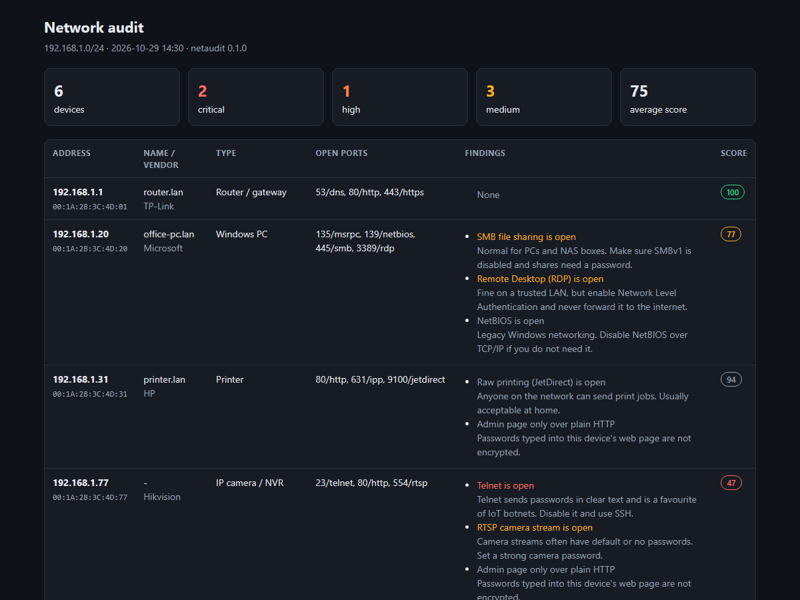

# netaudit

**Find every device on your network and flag the risky ones, in one command.**

`netaudit` sweeps your home or small-office LAN, works out what each device is, checks it for services that attackers love (Telnet, exposed ADB, open databases, default passwords), and gives every device a security score. It runs with zero dependencies beyond Python, on Windows, macOS and Linux.



```
$ netaudit scan

netaudit - 192.168.1.0/24 - 5 device(s)

    IP             MAC                VENDOR / NAME     TYPE                               OPEN PORTS                 SCORE
ok  192.168.1.1    00:1A:2B:3C:4D:01  router.lan        Router / gateway                   53/dns, 80/http, 443/https 100
!   192.168.1.238  00:1A:2B:3C:4D:EE  -                 Cast receiver / projector (HCCast) 80/http, 5000/upnp/airplay 62
!!  192.168.1.77   00:12:34:56:78:9A  -                 IP camera / NVR                    23/telnet, 554/rtsp        47
...

Findings:
  [CRITICAL] 192.168.1.77    Telnet is open
                             -> Telnet sends passwords in clear text and is a favourite of IoT botnets. Disable it and use SSH.
  [HIGH    ] 192.168.1.238   Default Wi-Fi Direct password
                             -> Anyone nearby can connect and cast to it. Change the password in the device's network settings.
```

## Install

```bash
pip install git+https://github.com/<your-username>/netaudit
netaudit update-oui    # optional, once: downloads the IEEE vendor list so MACs show manufacturers
```

## Usage

```bash
netaudit scan                                   # your local /24, common ports
netaudit scan 192.168.0.0/24 --html report.html # pretty, shareable report
netaudit scan --json today.json                 # save results...
netaudit scan --baseline today.json             # ...and later see new devices and newly opened ports
netaudit scan -p all                            # all 65,535 ports (slow)
netaudit scan --fail-on high                    # exit code 1 if anything high/critical is found (cron, CI)
```

## What it checks

| Check | Why it matters |
|---|---|
| Telnet (23, 2323) | Clear-text logins; the main way IoT botnets like Mirai spread |
| Android Debug Bridge (5555) | Gives anyone on the network a shell on TVs, boxes and projectors |
| FTP, VNC, Redis, MongoDB | Commonly left without passwords or encryption |
| RDP, SMB, NetBIOS | Normal on PCs, but worth knowing about and hardening |
| RTSP cameras, MQTT | Camera streams and smart-home traffic often have weak or no auth |
| Plain-HTTP admin pages | Router and device passwords sent unencrypted |
| HCCast projectors and dongles | Settings page is readable without login and often shows a default `12345678` password |
| New devices and ports | Compare with a previous scan to spot anything that just appeared |

Each device gets a score from 100 (nothing found) down to 0, and a guessed type (router, printer, camera, Windows PC, Cast device…) based on its ports and banners.

## How it works

1. **Discovery.** ICMP echo (via the native API on Windows, `ping` elsewhere) plus TCP probes to common ports, then the OS ARP cache for MAC addresses, which also catches devices that ignore ping.
2. **Port scan.** Concurrent TCP connect scan, no raw sockets or admin rights needed.
3. **Fingerprinting.** HTTP `Server` headers and page titles, plain-text banners, and a few device-specific probes.
4. **Rules.** Each finding has a severity, a plain-English explanation and a fix.

## Responsible use

Only scan networks you own or are authorized to test. By default `netaudit` refuses public IP ranges (`--allow-public` overrides) and ranges larger than 4,096 addresses (`--force`). It only opens TCP connections and reads banners; it never tries to log in or exploit anything.

## Development

```bash
git clone https://github.com/<your-username>/netaudit && cd netaudit
pip install -e ".[dev]"
pytest
```

Ideas and pull requests are welcome, especially new device probes and risk rules (see `src/netaudit/risks.py`).

## License

MIT
